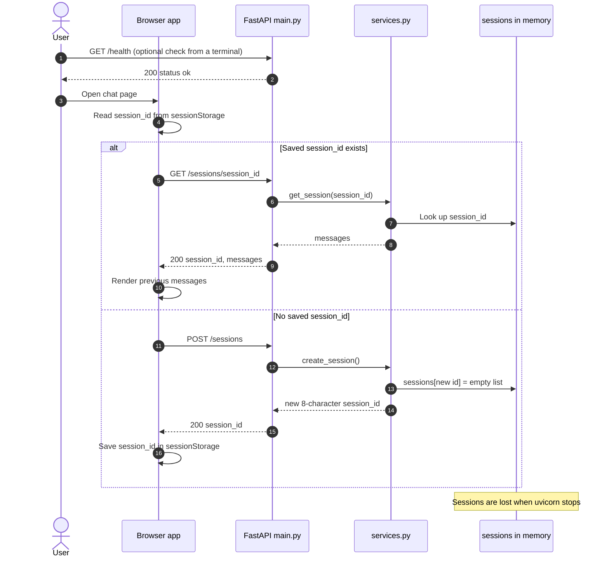
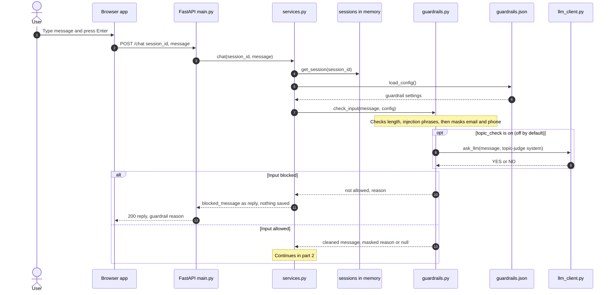
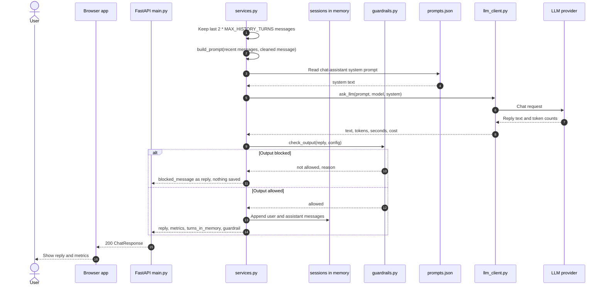
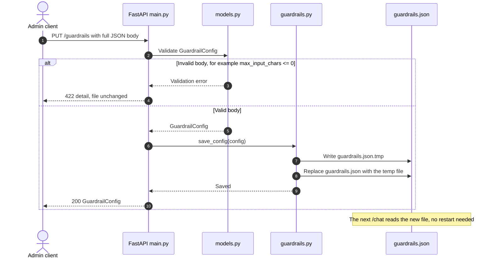
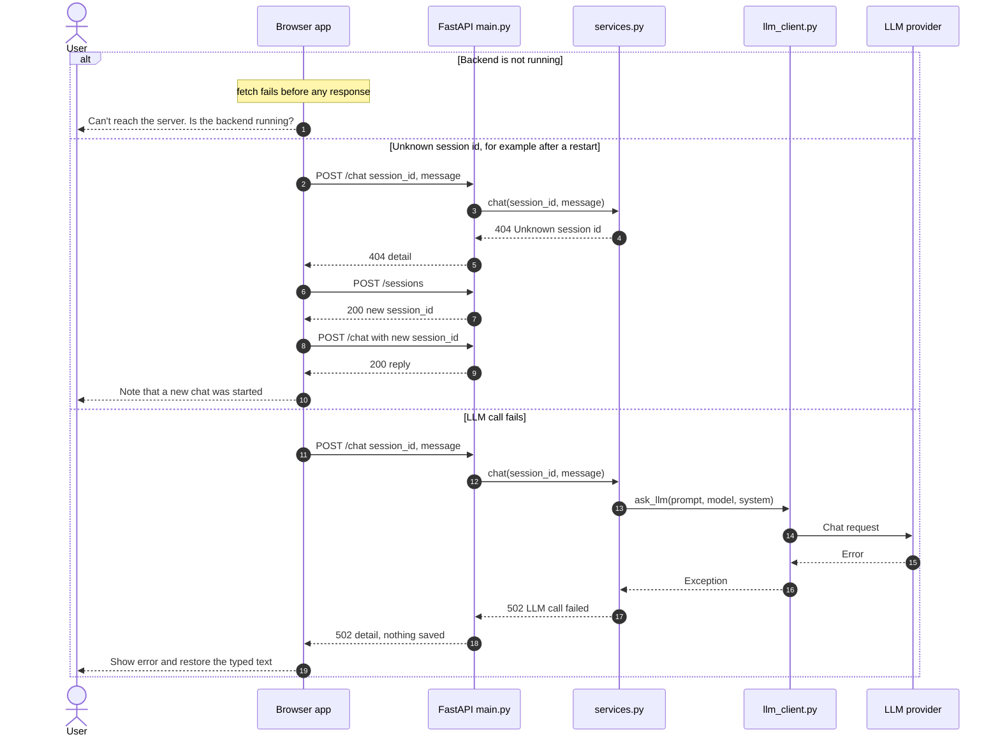

# Sequence diagrams

How requests flow through the chatbot, as built. Source: [backend/main.py](../backend/main.py), [backend/services.py](../backend/services.py), [backend/guardrails.py](../backend/guardrails.py), [frontend/app.js](../frontend/app.js).

## 1. Start a session

## 2. Send a message: input side

The last `2 * MAX_HISTORY_TURNS` messages are added to the prompt in part 2.

## 3. Send a message: prompt, LLM call and output side

## 4. Change the guardrails with PUT /guardrails

The frontend does not call this endpoint. An admin client such as curl or the FastAPI docs page sends it. The endpoint has no authentication.

## 5. Error paths

